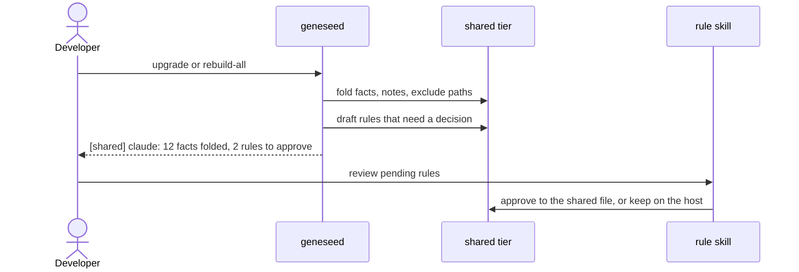

# Geneseed product requirements

Reconstructed from the code and [`DESIGN.md`](../DESIGN.md). The items marked `⚠ to confirm` are
inferred and wait for the maintainer's word.

<!-- geneseed:doc:start -->
## Problem

An AI coding agent starts each session with no standing rules, no memory of the last session, and
nothing that stops a risky action. Writing that setup by hand means one set of files per tool, in
each tool's own format, and it drifts. Geneseed authors the setup once and generates it for each
host, with hooks or plugins that enforce what the host allows.
<!-- geneseed:doc:end -->

<!-- geneseed:doc:start -->
## Users

- **Developer on one machine:** installs globally, and wants the agent's rules and memory in every repo.
- **Team maintainer:** installs per repo, and wants rules and gates committed beside the code.
- **Locked-down corporate user:** has no npm access, and installs and updates from a git clone.
- **Harness contributor:** edits `src/`, and needs to know what an addition costs ([`extending.md`](extending.md)).
<!-- geneseed:doc:end -->

<!-- geneseed:doc:start -->
## Goals

1. One neutral source, generated into each supported host (`src/`, `js/build/`).
2. Enforce at the tool boundary what a host can enforce, and say plainly what is only asked ([Enforced vs. asked](understand/enforced-vs-asked.md)).
3. Knowledge that outlives a session and is the same for every host on the machine ([The shared tier](concepts/shared-tier.md)).
4. Nothing lost: uninstall, upgrades and the fold keep user data.
5. Install and update without a build step or runtime dependencies ([ADR 0001](adr/0001-zero-runtime-dependencies.md)).
<!-- geneseed:doc:end -->

<!-- geneseed:doc:start -->
## Non-goals

- Geneseed does not manage MCP servers. It lists them read-only (`geneseed mcp`).
- It does not sync between machines. The shared tier covers one machine; use git or a vault to carry it further.
- It does not call a model API or hold an API key. `learn` uses the host's model or a CLI the user names.
- It does not bypass a host's permission mode: no emit grants a directory permission.
- `DESIGN.md` has the full list under *Explicitly out of scope*.
<!-- geneseed:doc:end -->

<!-- geneseed:doc:start -->
## User journeys

1. As a developer, I want one command to install the harness, so that every repo inherits it.
2. As a developer with two tools, I want a fact taught in one to reach the other, so that I teach it once.
3. As a developer, I want to be asked before a force-push or a credential write, so that a mistake does not cost data.
4. As a 4.x user, I want the upgrade to move my stores without loss, so that I do not migrate by hand.
5. As a maintainer, I want to see every install's state in one place, so that I can keep them current.

<!-- geneseed:doc:end -->

<!-- geneseed:doc:start -->
## Functional requirements

| ID | Requirement | Acceptance criteria | Status | Code |
|---|---|---|---|---|
| FR-001 | The generator renders one source into each host's install. | Each emit target renders without error; a second emit changes nothing | ✅ | `js/build/`, `tests/golden.mjs` |
| FR-002 | A theme changes voice only. | Same rules and structure in every theme; theme keys in parity | ✅ | `themes/`, `js/build/render.mjs` |
| FR-003 | A user chooses doctrine packs, single rules, skills and kits per install. | The choice survives a rebuild | ✅ | `js/build/args.mjs`, `js/build/generate.mjs` |
| FR-004 | Hook hosts gate git, writes and session context. | A blocked or asked call reaches the host's verdict channel | ✅ | `bin/geneseed-hook.mjs`, `js/hosts/hooks*.mjs` |
| FR-005 | OpenCode gets the same behaviour through plugins, on both plugin APIs. | The host loads every plugin | ✅ | `adapters/opencode/plugins/`, `tests/host_canary.mjs` |
| FR-006 | Global installs share memory, rules, profile, wiki manifest, exclude paths and notes. | Every global install reads the tier; project over host over shared | ✅ | `js/lib/machine-dir.mjs`, `js/hosts/hooks-context.mjs` |
| FR-007 | A global emit folds existing stores into the tier. | Copies read back before the old store moves; a second run writes nothing | ✅ | `js/build/fold.mjs` |
| FR-008 | A rule, profile or wiki that needs a decision waits in a draft. | A drafted rule stays in force on its host; only the `rule` skill or the console's Pending section decides | ✅ | `js/build/fold.mjs`, `js/build/rule-decide.mjs`, `src/skills/rule/approve.md` |
| FR-009 | A project install may opt in to read the tier. | Off by default; read-only and labelled; cost stated | ✅ | `js/inspect/cost.mjs`, `js/hosts/hooks-context.mjs` |
| FR-010 | The agent's memory is one fact per file, with a two-level index. | `geneseed memory list`, `rm` archive; `learn` updates and does not duplicate | ✅ | `js/hosts/memory-files.mjs`, `js/maintain/memory.mjs` |
| FR-011 | A folder can silence every global install. | `geneseed exclude add`; effect on the next tool call | ✅ | `js/inspect/excludes.mjs` |
| FR-012 | Uninstall removes only what the manifest owns. | User files stay; the tier is never touched | ✅ | `js/maintain/uninstall.mjs` |
| FR-013 | A clone updates itself with a checked pull; npm installs rebuild after an install. | A failed doctor rolls back; a doctor that cannot finish keeps the pull and rebuilds nothing | ✅ | `js/maintain/update.mjs` |
| FR-014 | `doctor`, `status`, `diff` and `validate` report state without changing it. | No install write | ✅ | `js/inspect/` |
| FR-015 | The web console shows the fleet and the shared stores once. | No install switch; default install selectable; rule costs shown with no limit; pending read-only; Update hidden when the pull cannot run | ✅ | `js/web/`, `web/src/` |
| FR-016 | Loops work a requirement as validated, committed iterations. | `geneseed loop` steps a state machine over `LOOP.md` | ✅ | `js/loop/` |
| FR-017 | Claude Code auto memory can be imported on request. | An explicit import verb | ✗ | Deferred past 5.0.0 |
<!-- geneseed:doc:end -->

<!-- geneseed:doc:start -->
## Non-functional requirements

| ID | Requirement | Threshold | Acceptance criteria | Status | Code |
|---|---|---|---|---|---|
| NFR-001 | No runtime dependencies. | 0 installed; vendored only | `tests/unit/dependency_policy.test.mjs` | ✅ | `js/vendor/` |
| NFR-002 | The hook is cheap: it loads on every tool call. | ~14 ms to load | Stated in `AGENTS.md`; no automated budget found, `⚠ to confirm` | ◐ | `bin/geneseed-hook.mjs` |
| NFR-003 | Context hook output stays under the host's cap. | 9 000 characters | `OUTPUT_BUDGET` | ✅ | `js/hosts/hooks-context.mjs` |
| NFR-004 | The rules file stays within its size ceiling. | 40 312 lean, 66 432 full | `CARRIER_CEILING` | ✅ | `js/inspect/cost.mjs` |
| NFR-005 | The generator and hook path cannot spawn beyond what is declared. | No `child_process` on the generator; one spawn site on the hook path | Closure walks | ✅ | `tests/unit/hook_cli.test.mjs` |
| NFR-006 | The upgrade doctor gate is bounded. | 300 s | A timeout reports a gate that did not finish | ✅ | `js/maintain/update.mjs` |
| NFR-007 | The console serves only this machine. | Local port 4747 by default, with request guards | [Web console security](web-ui.md#security-model) | ✅ | `js/web/server.mjs` |
| NFR-008 | Runs on Windows, macOS and Linux with no build step. | CI: Ubuntu and Windows. macOS: `⚠ to confirm`, no CI row | `web/dist/` tracked; `install`, `install.cmd`, `install.command` | ◐ | `.github/workflows/ci.yml` |
<!-- geneseed:doc:end -->
