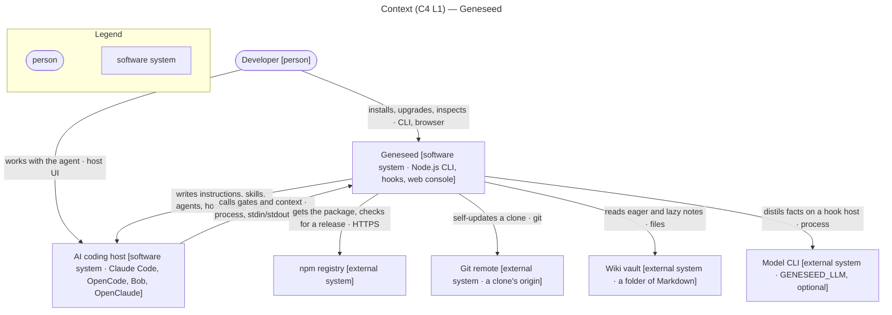
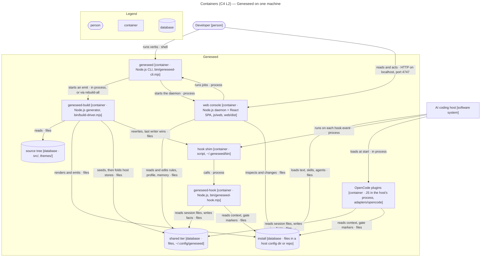
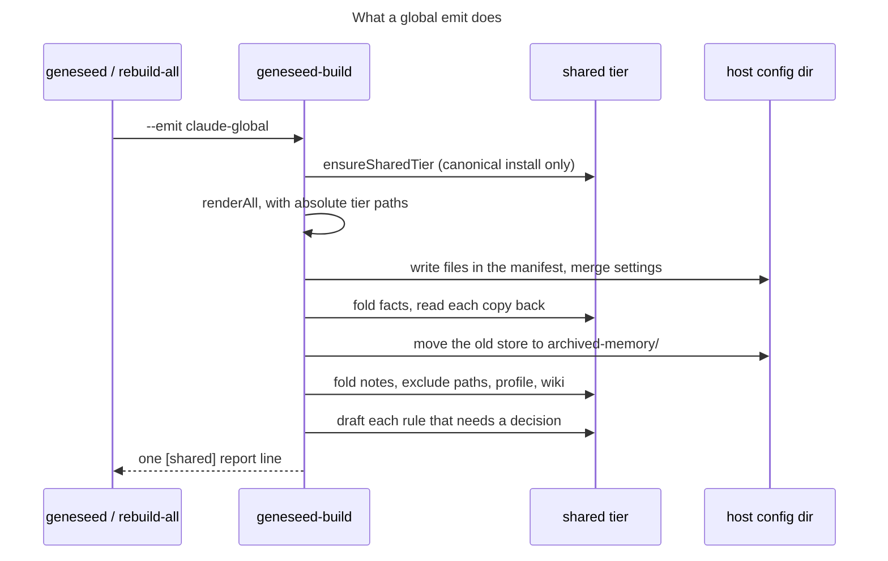

# Geneseed architecture

The short map is the root [`ARCHITECTURE.md`](../ARCHITECTURE.md): parts, invariants and the lines
that must not be crossed. The module map is [`js/README.md`](../js/README.md). This page adds the C4
views and how the pieces meet at run time. It repeats neither.

<!-- geneseed:doc:start -->
## Context (C4 L1)

A developer drives an AI coding host. Geneseed sits beside that host: it writes the host's
instructions, skills and agents, and answers the host's hook calls. It calls no model itself,
unless the user sets `GENESEED_LLM` for `learn` on a hook host.

Sources: `bin/geneseed-hook.mjs`, `js/hosts/settings.mjs`, `js/web/update-check.mjs`,
`js/maintain/update.mjs`, `js/hosts/hooks-learn.mjs`.
<!-- geneseed:doc:end -->

<!-- geneseed:doc:start -->
## Containers (C4 L2)

The stores are plain files: no server or database engine runs. `installs.json`, the install
registry, sits in the tier's folder and tells the CLI and the console which installs exist.

| Container | Must not | Enforced by |
|---|---|---|
| `geneseed-build` | spawn | closure walks in `tests/unit/hook_cli.test.mjs` ([ADR 0002](adr/0002-no-spawn-on-the-generator-and-hook-path.md)) |
| `geneseed-hook` | print anything but its verdict | `fuzz/`, the golden CLI matrix |
| `geneseed` | spawn beyond its allow-list | [ADR 0002](adr/0002-no-spawn-on-the-generator-and-hook-path.md) |
| OpenCode plugins | import from `js/`, or throw on OpenCode 2 | `tests/plugins/helper_parity.test.mjs` |

### Build and install flow

A non-canonical emit, such as `geneseed diff` into a temp folder, renders the same paths and
creates and folds nothing. [The shared tier](concepts/shared-tier.md) holds the user-facing rules.
<!-- geneseed:doc:end -->

<!-- geneseed:doc:start -->
## Decisions

The decisions are one file each in [`docs/adr/`](adr/README.md), and product decisions are in the
root [`DESIGN.md`](../DESIGN.md). They are not copied here. The structural ones behind this page:

- [0001](adr/0001-zero-runtime-dependencies.md) — vendored code, no installed runtime dependency.
- [0002](adr/0002-no-spawn-on-the-generator-and-hook-path.md) — who may spawn.
- [0004](adr/0004-uninstall-without-backups.md) — manifests and managed blocks.
- [0008](adr/0008-host-parity-ceiling-of-the-weakest-host.md) — a feature lands on every host.
- [0009](adr/0009-self-update-is-a-git-pull.md) — a clone updates itself with `git pull`.
- [0011](adr/0011-shared-tier.md) — one shared tier per machine.
<!-- geneseed:doc:end -->
